# Kelk — Markdown ⇆ Word (DOCX, DOC), PowerPoint (PPTX), Excel (XLSX, CSV), PDF and HTML — in the browser

**Kelk** (کِلک) converts **Markdown** — full **GitHub Flavored Markdown (GFM)** — into
**Word DOCX**, **Word DOC (MHTML)**, **PowerPoint slides (PPTX)**, **Excel workbooks (XLSX) and CSV**, **PDF** and a
**standalone HTML** page, and converts **Word .docx, PDF, HTML, CSV, Excel .xlsx and rich text back to Markdown**. It runs **100% client-side in your browser**:
no server, no upload, no account, no installation — it even works **offline** from `file://`.

It gets **right-to-left and bidirectional text** right — **Persian (Farsi), Arabic, Hebrew, Urdu,
Kurdish** mixed with English — and works just as well for **every left-to-right language**
(English, French, German, Spanish, Greek, Russian …). Interface in **English, فارسی and العربية**.
Free and open source (MIT).

**▶ [Open Kelk online](https://mohsen-1984.github.io/kelk/)** ·
**⬇ [Download kelk_2.6.zip](https://github.com/mohsen-1984/kelk/releases/latest/download/kelk_2.6.zip)** ·
[فارسی ↓](#fa) · [العربية ↓](#ar) · Contact: [mhn.com@gmail.com](mailto:mhn.com@gmail.com)

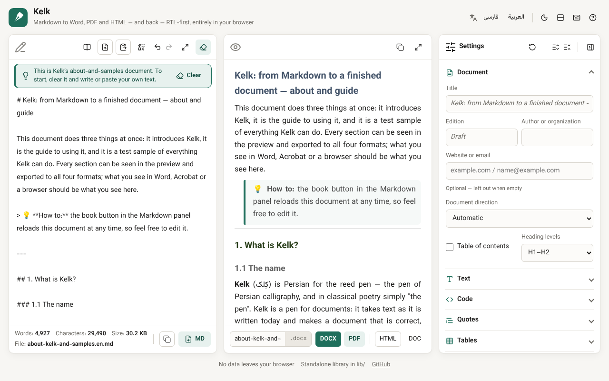

## What it does

- **Markdown → DOCX** with real Word styles (Heading, Quote, List Paragraph, TOC) — ready to edit.
- **Markdown → PDF** with its own layout engine: Arabic-script shaping, diacritics (harakat),
  embedded fonts, page numbers, a **table of contents with page numbers and links**, bookmarks.
- **Markdown → DOC (MHTML)** for Microsoft Word with a completely free-form header and footer.
- **Markdown → HTML**: one standalone file with fonts, styles and images embedded.
- **Markdown → PowerPoint (PPTX)**: every `##` is a slide, and the preview switches between **Document**
  and **Slides**. Layouts come from the content (cards, steps, stats, timelines horizontal or vertical,
  columns, agenda). Diagrams are PowerPoint shapes (process, cycle, pyramid, hierarchy, matrix, Venn),
  charts are made from tables (Edit Data works), speaker notes come from comments, and Lucide icons and
  callouts are supported. Right-to-left decks are mirrored. Everything stays editable, and a full-screen
  Present mode is included. In Slides the only export is PPTX; a text plainly not in slide format stays a
  document, with a note on why. The convention, and a prompt that teaches it to AI models: [`lib/SLIDES.md`](lib/SLIDES.md).
- **Markdown ⇆ Excel (XLSX) and CSV**: the preview's third view, **Excel**, shows each table as a sheet (its name
  from the heading above it, its rows and columns, its first rows), and the exports are **XLSX** and a zip of
  **CSV** files. The workbook comes formatted for Persian and English alike: a right-to-left sheet when any cell is Persian, Arabic or Hebrew,
  fonts and alignment by content, a colored, frozen header row with a filter, stripes, column widths, print setup;
  leading zeros and long numbers stay text. **Excel and CSV → Markdown:** a CSV (UTF-8, or Windows-1256 from Persian Excel), a zip of
  CSVs or an XLSX becomes a heading and a table per sheet, ready to edit or hand to a model. CSV is to Excel what
  Markdown is to Word: a model that cannot make files can still answer in CSV.
- **DOCX / PDF / HTML / pasted rich text → Markdown** — clean input for AI models (fewer tokens, clear structure);
  several files or a .zip at once become one document, in the order you set: a window lists them with the icon of
  their kind, and marks those that cannot be converted.
  PDFs from browsers, Word, LibreOffice, Excel and others come back with their headings, lists, tables
  (ruled or not, across pages, with merged cells), code, quotes and links; in Persian and Arabic with their ZWNJs,
  letters and digits repaired; formulas in Kelk's own PDFs come back as their LaTeX. A PDF is made for print: review what
  comes back, and a scan needs an OCR layer ([how it works, and its limits](lib/PDFIMPORT.md)).
- **Clean up a Word document:** import a messy .docx and export DOCX again — direction and alignment set right
  per paragraph, cell and list item, one set of real Word styles, uniform tables, stray formatting gone.
- **Full GFM** ([spec](https://github.github.com/gfm/)): tables with alignment, task lists,
  nested lists, strikethrough, fenced code with syntax highlighting, quotes, links, images.
- **Images**: drop or paste a picture into the text (embedded in every output), use a public web
  URL, or add a logo to the header.
- **Bidirectional text done right**: the direction of every paragraph, list item, quote and table
  cell; numbers, brackets, formulas and English words inside RTL text keep their order.
- **LaTeX formulas** (`$…$`, `$$…$$`, `\(…\)`, `\[…\]`) in the preview and all four outputs:
  editable **Word equations** in DOCX and DOC, vectors in PDF, SVG or MathML in HTML — and Word
  equations come back as LaTeX on import. Local MathJax, no network.
- **Table styles**: lines (none, under the header, horizontal, vertical, frame, grid) × fill (none,
  colored header, zebra stripes, both), three colors and a total row — the same in every output;
  code blocks and quotes have their own colors.
- Maximize the editor or the preview; *Clear & paste* turns the clipboard into the document; light and dark theme.
- Header and footer (structured, simple or custom HTML), automatic title and edition, one font choice for
  every output (or other fonts for DOCX and PPTX; XLSX has its own, since Excel cannot embed fonts), fonts embedded in DOCX and PPTX, A3–A5/Letter/Legal pages, a monospace code font made for Persian and Arabic.

| Output | Best for | Fonts |
|---|---|---|
| **PDF** | sending, sharing, printing — the easiest | embedded |
| **DOCX** | editing in Word | must be installed on the reader's computer |
| **DOC** (MHTML) | a free-form header/footer; Microsoft Word only | must be installed |
| **HTML** | a standalone page for the web or an archive | embedded |
| **PPTX** | a talk: editable slides, charts and diagrams, speaker notes | must be installed |
| **XLSX** | data in Excel: each table a sheet, formatted | must be installed (Excel cannot embed fonts) |
| **CSV** | data for any tool or model: a zip, one file per sheet | — |

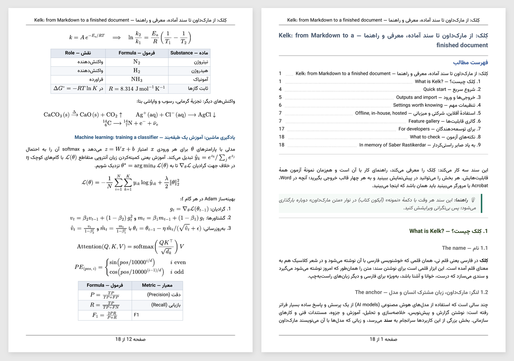

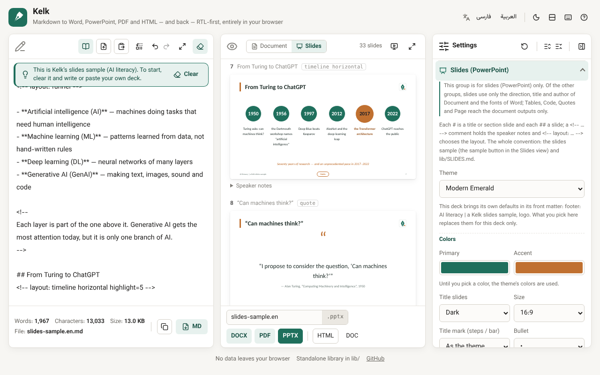

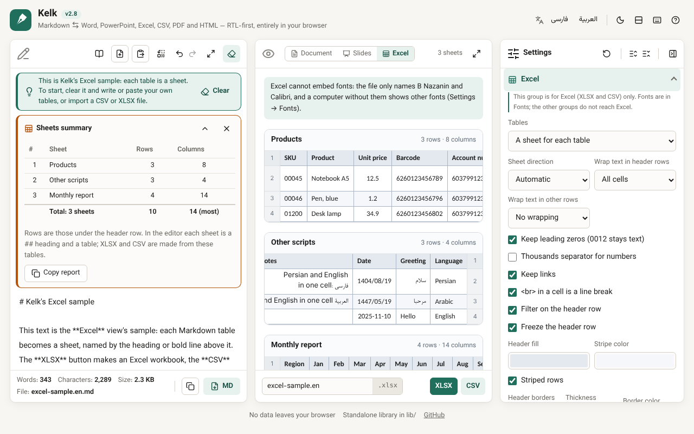

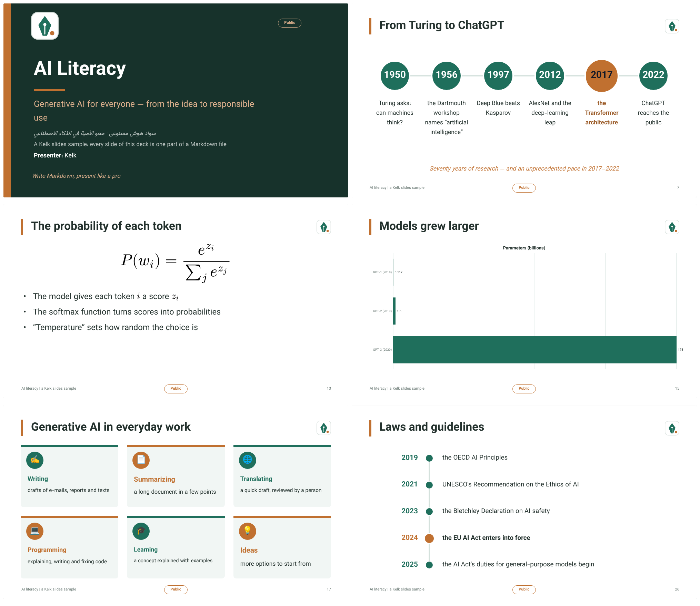

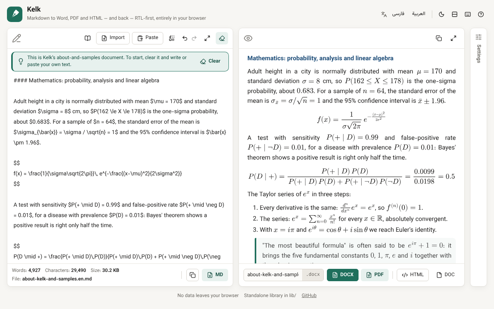

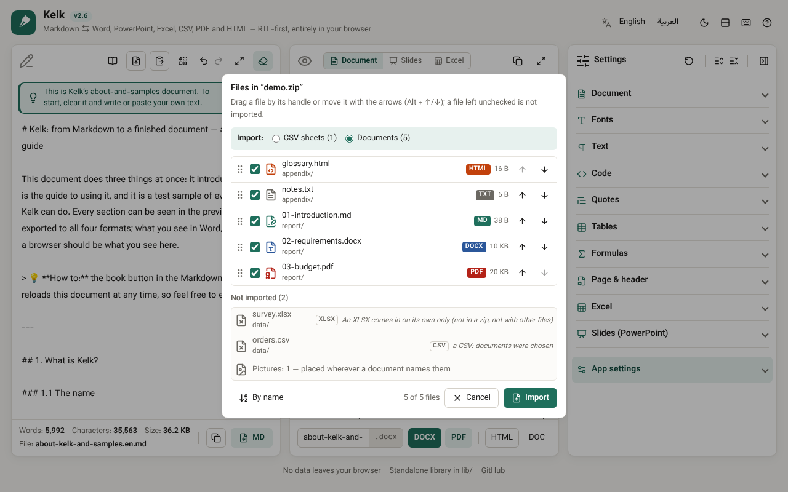

## Use it

- **Online:** [mohsen-1984.github.io/kelk](https://mohsen-1984.github.io/kelk/).
- **On your computer:** [download kelk_2.6.zip](https://github.com/mohsen-1984/kelk/releases/latest/download/kelk_2.6.zip),
  unpack it and open `index.html` — offline, for personal use or inside a company network.
- **On your own host:** upload the folder to any static web host.

The about-and-guide document opens on the first visit, in the interface language:
[English](docs/about-kelk-and-samples.en.md) · [فارسی](docs/about-kelk-and-samples.fa.md) ·
[العربية](docs/about-kelk-and-samples.ar.md).

## For developers

`lib/` is a **standalone JavaScript library** with no build step: four builders with one API —
`DocxBuilder` (.docx, on docx.js), `PdfBuilder` (.pdf, on jsPDF), `WordHtmlBuilder` (.doc),
`HtmlBuilder` (.html) and `PptxBuilder` (.pptx slides, on PptxGenJS) — plus `XlsxBuilder` (.xlsx and CSV, on SheetJS),
`SheetImporter` (CSV and .xlsx → Markdown, on PapaParse and SheetJS), `PreviewBuilder` (a live preview in a page element, on
`HtmlBuilder`'s logic and stylesheet), `BidiCore` (every direction decision), `MarkdownImporter`
(.docx/HTML → Markdown) and `PdfImporter` (.pdf → Markdown, on pdf.js). Any font can be prepared for the PDF with `tools/build_pdf_fonts.py`.
Documentation: **[`lib/README.md`](lib/README.md)**; the reasons behind formulas and PDF import:
[`lib/LATEX.md`](lib/LATEX.md), [`lib/PDFIMPORT.md`](lib/PDFIMPORT.md), and the slide convention: [`lib/SLIDES.md`](lib/SLIDES.md).

```js
const pdf = await PdfBuilder.create()
    .registerFonts(window.PdfFonts)
    .configure({ fonts: { bidi: 'Vazirmatn', latin: 'Vazirmatn' }, toc: { levels: 2 } })
    .addFromHtml(marked.parse(markdown))
    .toBlob();
```

```text
index.html     the page            scripts/, styles/   the page's code (window.Kelk)
lib/           the library         assets/             icons and web fonts
vendor/        third-party libraries (pinned versions; THIRD-PARTY-NOTICES.md)
docs/          about + guide + samples (en / fa / ar), screenshots, RELEASING.md (the release checklist)
tests/         builder-suite.html — every test case through the four document builders, in the browser ·
               slides-suite.html — the slides: layouts, notes, warnings, the .pptx read back ·
               pdf-import-suite.html — PDFs you pick, scored offline ·
               pdf-lab/ — 196 PDFs (our generators and real Windows producers), scored, fuzzed and gated (Node + Playwright)
tools/         bidi-lab.html (every direction rule) · build_pdf_fonts.py · build-icons.js · build-samples.js · og-image.html (source of assets/og-image.png)
               · check-*.js (version, interface strings, accessibility, startup size) · build-release.sh (the two zips)
.github/       CI on every push: the PDF lab and its gate, the builders against golden snapshots, .docx checked
               against the OOXML schemas, unit tests, lint, links, accessibility; the release zips, attached to each release
package.json   the dev tools CI installs (npm ci) — the app itself has no build step and no dependencies to install
```

Release downloads: `kelk_2.6.zip` is the app (what most people want); `kelk-with-pdf-lab_2.6.zip` adds
`tests/pdf-lab/` (196 PDFs, about 25 MB) for working on the PDF importer.

## Contact, credits, license

Questions and suggestions: **[mhn.com@gmail.com](mailto:mhn.com@gmail.com)** (e-mail is the best
way; this repository is not watched every day).
Code: **MIT** ([`LICENSE`](LICENSE)); libraries and fonts keep their own licenses
([`THIRD-PARTY-NOTICES.md`](THIRD-PARTY-NOTICES.md)).
Vazirmatn, Vazir Code and Sahel are the work of the late
[Saber Rastikerdar](https://github.com/rastikerdar) — in his memory.
B Nazanin, B Mitra and B Titr: (c) Borna Rayaneh, no published license, see borna-rayaneh/NOTICE.txt
([`lib/pdf-base64-ttf-fonts/borna-rayaneh/NOTICE.txt`](lib/pdf-base64-ttf-fonts/borna-rayaneh/NOTICE.txt)).

---

<a id="fa"></a>
<div dir="rtl">

## کِلک — مارک‌داون ⇆ Word، PowerPoint، Excel، PDF و HTML، در مرورگر

**کِلک** متن **مارک‌داون** — با پشتیبانی کامل از **GitHub Flavored Markdown (GFM)** — را به
**Word DOCX**، **Word DOC (MHTML)**، **اسلایدهای PowerPoint (PPTX)**، **کارپوشهٔ اکسل (XLSX) و CSV**، **PDF** و یک صفحهٔ
**HTML مستقل** تبدیل می‌کند، و فایل **Word (.docx)، PDF، HTML، CSV، اکسل (.xlsx) و متن کپی‌شده از Word یا وب را به مارک‌داون** برمی‌گرداند. همه‌چیز
**کاملاً در مرورگر شما (client-side)** انجام می‌شود: بدون سرور، بدون بارگذاری فایل، بدون حساب کاربری
و بدون نصب؛ حتی **بدون اینترنت** و مستقیم از `file://` کار می‌کند.

متن **راست‌به‌چپ و دوجهتی (BiDi)** — **فارسی، عربی، عبری، اردو، کردی** در کنار انگلیسی — را درست
می‌چیند و برای **همهٔ زبان‌های چپ‌به‌راست** هم به همان خوبی کار می‌کند. رابط کاربری به فارسی،
English و العربية است. رایگان و متن‌باز (MIT).

**▶ [کِلک برخط](https://mohsen-1984.github.io/kelk/)** ·
**⬇ [دریافت kelk_2.6.zip](https://github.com/mohsen-1984/kelk/releases/latest/download/kelk_2.6.zip)** ·
تماس: [mhn.com@gmail.com](mailto:mhn.com@gmail.com)

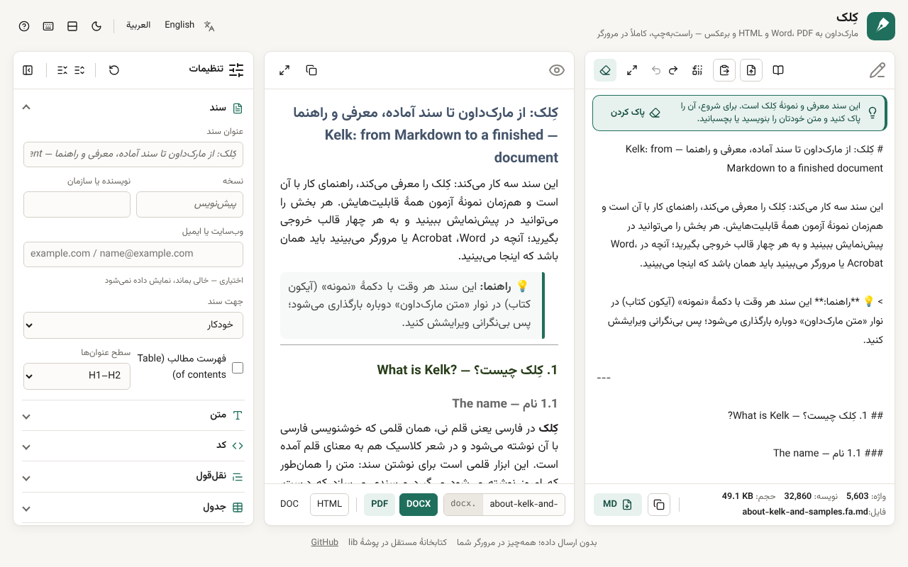

### قابلیت‌ها

- **مارک‌داون به DOCX** با سبک‌های واقعی Word؛ آمادهٔ ویرایش.
- **مارک‌داون به PDF** با موتور چیدمان خود کِلک: شکل‌دهی حروف، حرکت‌گذاری، قلم‌های درون فایل، شمارهٔ صفحه و **فهرست مطالب با شمارهٔ صفحه و پیوند**.
- **مارک‌داون به DOC (MHTML)** برای Microsoft Word، با سربرگ و پانویس کاملاً آزاد.
- **مارک‌داون به HTML**: یک فایل مستقل با قلم‌ها، سبک‌ها و تصویرهای درون فایل.
- **مارک‌داون به PowerPoint (PPTX)**: هر `##` یک اسلاید است و پیش‌نمایش میان «سند» و «اسلاید» جابه‌جا می‌شود. چیدمان اسلاید از روی محتوا انتخاب می‌شود: کارت، گام‌ها، آمار، گاه‌شمار افقی یا عمودی، چندستونی و فهرست مطالب. نمودار وِن، چرخه، هرم، فرایند، ماتریس و درخت (سلسله‌مراتب) با شکل‌های خود PowerPoint ساخته می‌شوند، و نمودار داده از روی جدول (با Edit Data). یادداشت سخنران از کامنت‌ها می‌آید و نماد Lucide و کادر نکته هم پشتیبانی می‌شود. ارائهٔ راست‌به‌چپ قرینه چیده می‌شود. همه‌چیز قابل ویرایش است و نمایش تمام‌صفحه هم دارد. در نمای اسلاید تنها خروجی PPTX است؛ متنی که پیداست قالب اسلاید ندارد در نمای سند می‌ماند و یادداشتی دلیلش را می‌گوید. قاعدهٔ اسلاید و پرامپت آموزش آن به مدل‌ها: [`lib/SLIDES.md`](lib/SLIDES.md).
- **مارک‌داون ⇆ اکسل (XLSX) و CSV**: نمای سوم پیش‌نمایش، **اکسل**، هر جدول را یک شیت نشان می‌دهد (نامش از عنوان بالای آن، تعداد سطر و ستون، و سطرهای اول) و خروجی‌ها **XLSX** و یک zip از فایل‌های **CSV** است. کارپوشه برای فارسی و انگلیسی قالب‌بندی‌شده می‌آید: شیت راست‌به‌چپ وقتی سلولی فارسی، عربی یا عبری دارد، فونت و چینش بر اساس محتوا، سرستون رنگی و ثابت با فیلتر، سطرهای راه‌راه، پهنای ستون و تنظیمات چاپ؛ صفرهای ابتدایی و عددهای طولانی متن می‌مانند. **اکسل و CSV به مارک‌داون:** یک CSV (UTF-8 یا Windows-1256 اکسل فارسی)، یک zip از CSVها یا یک XLSX، برای هر شیت یک عنوان و یک جدول می‌شود؛ آمادهٔ ویرایش یا دادن به مدل. CSV برای اکسل همان است که مارک‌داون برای Word: مدلی که نمی‌تواند فایل بسازد هم می‌تواند پاسخ را CSV بدهد.
- **DOCX، PDF، HTML و متن کپی‌شده به مارک‌داون**: ورودی تمیز برای مدل‌های هوش مصنوعی؛ توکن کمتر و ساختار روشن‌تر؛ چند فایل یا یک zip با هم یک سند می‌شوند، به ترتیبی که خودتان تعیین می‌کنید: پنجره‌ای فایل‌ها را با نماد نوعشان فهرست می‌کند و فایل‌های غیرقابل تبدیل را جدا نشان می‌دهد. فایل PDF ساخته‌شده با مرورگر، Word، LibreOffice، Excel و برنامه‌های دیگر با عنوان‌ها، فهرست‌ها، جدول‌ها (با خط یا بی‌خط، حتی در چند صفحه، با خانه‌های ادغام‌شده)، کد، نقل‌قول و پیوندهایش برمی‌گردد؛ در فارسی و عربی با نیم‌فاصله‌ها، حروف و رقم‌های اصلاح‌شده؛ فرمول‌های PDFهای خود کِلک با همان LaTeX. PDF برای چاپ ساخته شده: نتیجه را بازبینی کنید؛ فایل اسکن‌شده لایهٔ OCR می‌خواهد ([چگونگی کار و محدودیت‌ها](lib/PDFIMPORT.md)).
- **یکدست‌سازی و پاک‌سازی سند Word:** فایل docx به‌هم‌ریخته را وارد کنید و دوباره DOCX بگیرید: جهت و تراز هر پاراگراف، سلول و آیتم فهرست درست، یک مجموعه سبک واقعی Word، جدول‌های هم‌شکل و بدون قالب‌بندی‌های پراکنده.
- **پشتیبانی کامل از GFM** ([مشخصات](https://github.github.com/gfm/)): جدول با ترازبندی، فهرست کارها، فهرست تودرتو، خط‌خوردگی، بلوک کد با رنگ‌آمیزی، نقل‌قول، پیوند و تصویر.
- **تصویر:** کشیدن یا چسباندن تصویر در متن (در همهٔ خروجی‌ها جاسازی می‌شود)، نشانی عمومی وب، یا لوگو در سربرگ.
- **دوجهتی درست:** جهت هر پاراگراف، آیتم فهرست، نقل‌قول و سلول جدول؛ عددها، پرانتزها، فرمول‌ها و واژه‌های انگلیسی ترتیبشان را حفظ می‌کنند.
- **فرمول‌های LaTeX** (`$…$`، `$$…$$`، `\(…\)` و `\[…\]`) در پیش‌نمایش و هر چهار خروجی: **معادلهٔ قابل ویرایش Word** در DOCX و DOC، برداری (vector) در PDF، و SVG یا MathML در HTML؛ معادله‌های Word هنگام ورود به LaTeX برمی‌گردند. MathJax محلی، بدون اینترنت.
- **سبک جدول (Table style):** خطوط (بدون خط، زیر عنوان، افقی، عمودی، قاب، شبکه‌ای) × پس‌زمینه (بدون رنگ، عنوان رنگی، راه‌راه یا هر دو)، سه رنگ و سطر جمع؛ در همهٔ خروجی‌ها یکسان. بلوک کد و نقل‌قول هم رنگ‌های خودشان را دارند.
- بزرگ‌کردن ویرایشگر یا پیش‌نمایش؛ «پاک کردن و چسباندن» (Clear & paste) محتوای کلیپ‌بورد را سند می‌کند؛ پوستهٔ روشن و تیره.
- سربرگ و پانویس (ساختاریافته، ساده یا HTML دلخواه)، عنوان و نسخهٔ خودکار، یک انتخاب فونت برای همهٔ خروجی‌ها (یا فونت دیگری برای DOCX و PPTX؛ XLSX فونت‌های خودش را دارد، چون اکسل فونت را درون فایل نمی‌گذارد)، فونت‌های جاسازی‌شده در DOCX و PPTX، صفحه‌های A3 تا A5، Letter و Legal، و قلم کد هم‌عرض (monospace) که برای فارسی و عربی ساخته شده.

| خروجی | مناسب برای | قلم‌ها |
|---|---|---|
| **PDF** | ارسال، اشتراک و چاپ؛ ساده‌ترین | درون فایل |
| **DOCX** | ویرایش در Word | باید روی رایانهٔ خواننده نصب باشد |
| **DOC** (MHTML) | سربرگ و پانویس آزاد؛ فقط Microsoft Word | باید نصب باشد |
| **HTML** | صفحهٔ مستقل برای وب یا بایگانی | درون فایل |
| **PPTX** | ارائه: اسلاید، نمودار و دیاگرام قابل ویرایش، یادداشت سخنران | باید نصب باشد |
| **XLSX** | داده در اکسل: هر جدول یک شیت، قالب‌بندی‌شده | باید نصب باشد (اکسل فونت را درون فایل نمی‌گذارد) |
| **CSV** | داده برای هر ابزار و مدل: یک zip، یک فایل برای هر شیت | — |

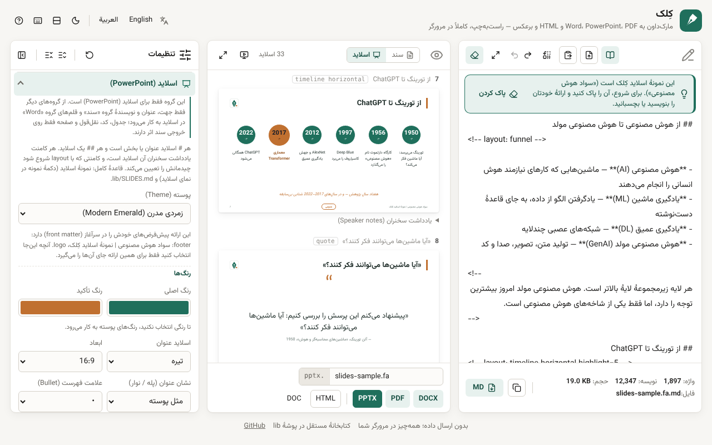

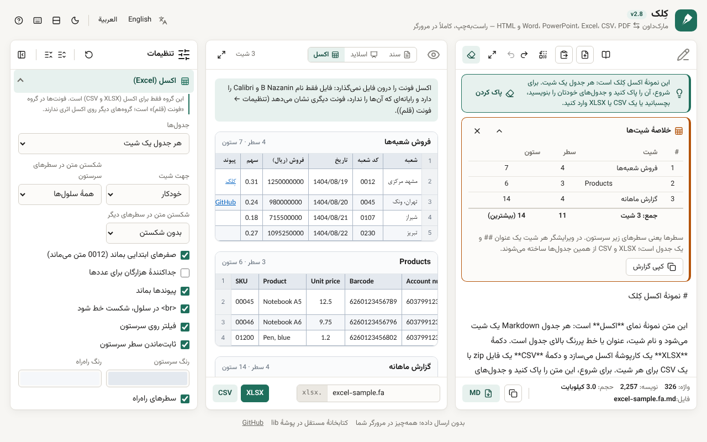

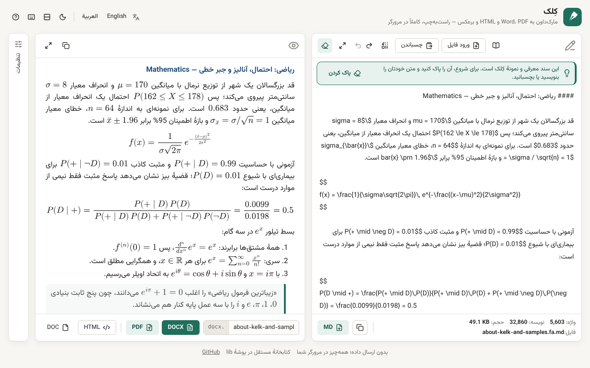

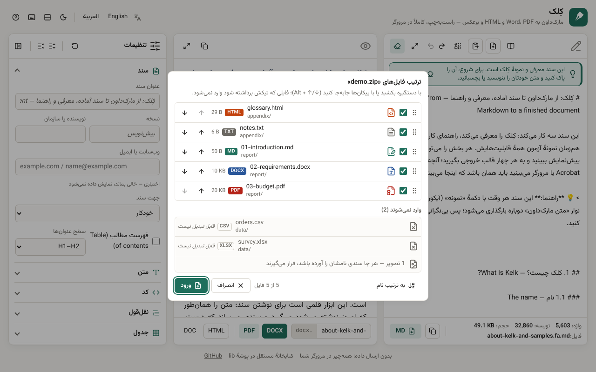

### استفاده

- **برخط:** [mohsen-1984.github.io/kelk](https://mohsen-1984.github.io/kelk/)
- **روی رایانه:** [kelk_2.6.zip](https://github.com/mohsen-1984/kelk/releases/latest/download/kelk_2.6.zip) را دریافت کنید، باز کنید و `index.html` را باز کنید؛ بدون اینترنت، برای استفادهٔ شخصی یا در شبکهٔ داخلی شرکت.
- **روی میزبان خودتان:** پوشه را روی هر میزبان وب ایستا بارگذاری کنید.

سند معرفی و راهنما در نخستین بازدید به زبان رابط کاربری باز می‌شود:
[فارسی](docs/about-kelk-and-samples.fa.md) · [English](docs/about-kelk-and-samples.en.md) ·
[العربية](docs/about-kelk-and-samples.ar.md).
پوشهٔ `lib/` یک کتابخانهٔ مستقل جاوااسکریپت است؛ مستندات آن به انگلیسی: [`lib/README.md`](lib/README.md).

### تماس، قدردانی و مجوز

پرسش و پیشنهاد: **[mhn.com@gmail.com](mailto:mhn.com@gmail.com)** (بهترین راه ارتباط ایمیل است).
کد با **مجوز MIT** منتشر شده؛ کتابخانه‌ها و قلم‌ها مجوز خودشان را دارند (`THIRD-PARTY-NOTICES.md`).
Vazirmatn، Vazir Code و Sahel کار زنده‌یاد [صابر راستی‌کردار](https://github.com/rastikerdar) است؛ یادش گرامی.
بی‌نازنین، بی‌میترا و بی‌تیتر: (c) Borna Rayaneh, no published license, see borna-rayaneh/NOTICE.txt
([`lib/pdf-base64-ttf-fonts/borna-rayaneh/NOTICE.txt`](lib/pdf-base64-ttf-fonts/borna-rayaneh/NOTICE.txt)).

</div>

---

<a id="ar"></a>
<div dir="rtl">

## كِلك — ماركداون ⇆ Word وPowerPoint وExcel وPDF وHTML، في المتصفح

يحوّل **كِلك** نص **ماركداون** — مع دعم كامل لـ **GitHub Flavored Markdown (GFM)** — إلى
**Word DOCX** و**Word DOC (MHTML)** و**شرائح PowerPoint (PPTX)** و**مصنفات Excel (XLSX) وCSV** و**PDF** وصفحة **HTML مستقلة**،
ويعيد **ملفات Word (.docx) وPDF وHTML وCSV وExcel (.xlsx) والنص المنسوخ من Word أو الويب إلى ماركداون**. يعمل كل شيء **بالكامل في متصفحك
(client-side)**: بلا خادم، ولا رفع ملفات، ولا حساب، ولا تثبيت؛ ويعمل حتى **دون إنترنت** من `file://`.

يعالج **النصوص من اليمين إلى اليسار وثنائية الاتجاه (BiDi)** — **العربية والفارسية والعبرية
والأردية والكردية** مع الإنجليزية — ويعمل بالجودة نفسها **لكل لغات الكتابة من اليسار إلى اليمين**.
الواجهة بالعربية والفارسية والإنجليزية. مجاني ومفتوح المصدر (MIT).

**▶ [كِلك على الإنترنت](https://mohsen-1984.github.io/kelk/)** ·
**⬇ [تنزيل kelk_2.6.zip](https://github.com/mohsen-1984/kelk/releases/latest/download/kelk_2.6.zip)** ·
للتواصل: [mhn.com@gmail.com](mailto:mhn.com@gmail.com)

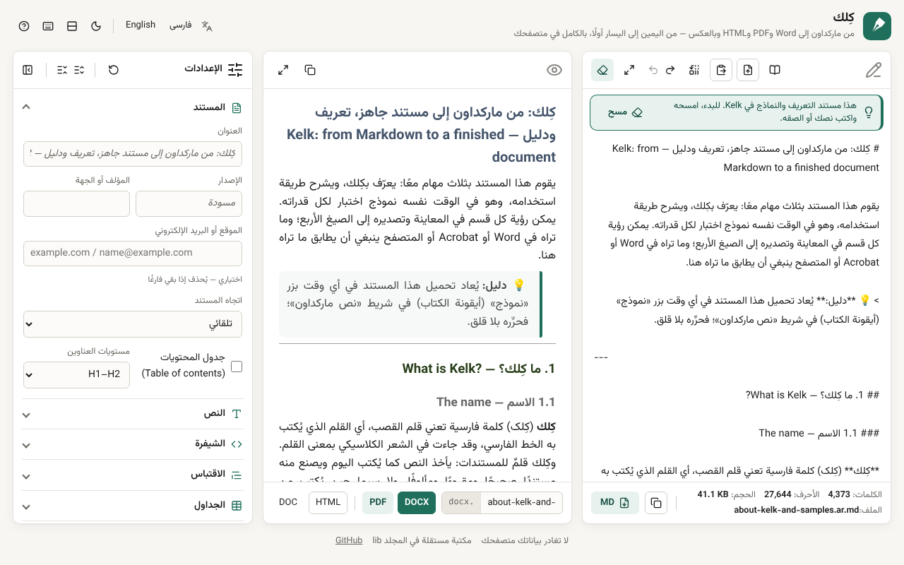

### القدرات

- **ماركداون إلى DOCX** بأنماط Word حقيقية، جاهز للتحرير.
- **ماركداون إلى PDF** بمحرّك تخطيط خاص: تشكيل الحروف العربية، والحركات، والخطوط المضمَّنة، وأرقام الصفحات، و**جدول محتويات بأرقام الصفحات والروابط**.
- **ماركداون إلى DOC (MHTML)** لبرنامج Microsoft Word، برأس وتذييل حرّين تمامًا.
- **ماركداون إلى HTML**: ملف واحد مستقل بخطوطه وأنماطه وصوره.
- **ماركداون إلى PowerPoint (PPTX)**: كل `##` شريحة، وتنتقل المعاينة بين «مستند» و«شرائح». يُختار تخطيط الشريحة بحسب محتواها: بطاقات، وخطوات، وإحصاءات، وخط زمني أفقي أو عمودي، وأعمدة، وجدول محتويات. تُرسم المخططات بأشكال PowerPoint نفسها: عملية، ودورة، وهرم، وتسلسل هرمي، ومصفوفة، وفِن. وتُصنع مخططات البيانات من الجداول (مع Edit Data)، وتأتي ملاحظات المتحدث من التعليقات، وتُدعم أيقونات Lucide ومربعات الملاحظة. تُعكس شرائح العروض من اليمين إلى اليسار. كل شيء قابل للتحرير، ويتوفر عرض بملء الشاشة. في عرض الشرائح التصدير الوحيد هو PPTX؛ والنص الذي ليس بتنسيق الشرائح بوضوح يبقى مستندًا، مع ملاحظة تبيّن السبب. القاعدة وموجّه يعلّمها لنماذج الذكاء الاصطناعي: [`lib/SLIDES.md`](lib/SLIDES.md).
- **ماركداون ⇆ Excel (XLSX) وCSV**: العرض الثالث في المعاينة، **Excel**، يعرض كل جدول ورقةً (اسمها من العنوان فوقه، وعدد صفوفها وأعمدتها، وصفوفها الأولى)، والتصدير **XLSX** وملف zip من ملفات **CSV**. ويأتي المصنف منسَّقًا للعربية والإنجليزية معًا: ورقة من اليمين إلى اليسار حين تحوي خليةً عربية أو فارسية أو عبرية، وخطوط ومحاذاة بحسب المحتوى، وصف عناوين ملوّن مثبّت مع عامل تصفية، وصفوف مخططة، وعرض أعمدة، وإعدادات طباعة؛ وتبقى الأصفار في البداية والأعداد الطويلة نصًّا. **من Excel وCSV إلى ماركداون:** ملف CSV (UTF-8 أو Windows-1256 من Excel العربي والفارسي) أو zip من ملفات CSV أو ملف XLSX يصبح عنوانًا وجدولًا لكل ورقة، جاهزًا للتحرير أو لإعطائه نموذجًا. ملف CSV بالنسبة إلى Excel كالماركداون بالنسبة إلى Word: النموذج الذي لا يصنع ملفات يستطيع أن يجيب بـ CSV.
- **DOCX وPDF وHTML والنص الملصوق إلى ماركداون**: مدخلات نظيفة لنماذج الذكاء الاصطناعي؛ رموز أقل وبنية أوضح؛ وتصبح عدة ملفات أو ملف zip مستندًا واحدًا بالترتيب الذي تحدده: تعرض نافذة الملفات برمز نوعها، وتميّز الملفات التي لا يمكن تحويلها. يعود ملف PDF المصنوع بالمتصفح أو Word أو LibreOffice أو Excel وغيرها بعناوينه وقوائمه وجداوله (بخطوط أو دونها، وعبر الصفحات، مع الخلايا المدمجة) وشيفرته واقتباساته وروابطه؛ وبالعربية والفارسية مع إصلاح فواصل ZWNJ والحروف والأرقام؛ وتعود صيغ ملفات PDF التي صنعها كِلك بنص LaTeX نفسه. صُنع PDF للطباعة: راجع النتيجة، والملف الممسوح ضوئيًا يحتاج إلى طبقة OCR ([كيف يعمل وحدوده](lib/PDFIMPORT.md)).
- **توحيد مستند Word وتنظيفه:** استورد ملف docx مبعثرًا وصدّره DOCX من جديد: اتجاه كل فقرة وخلية وعنصر قائمة ومحاذاته صحيحان، ومجموعة واحدة من أنماط Word الحقيقية، وجداول متشابهة، بلا تنسيقات متفرقة.
- **دعم كامل لـ GFM** ([المواصفات](https://github.github.com/gfm/)): جداول بمحاذاة، وقوائم مهام، وقوائم متداخلة، وشطب، وكتل شيفرة ملوّنة، واقتباسات، وروابط، وصور.
- **الصور:** سحب الصورة أو لصقها في النص (تُضمَّن في كل الصيغ)، أو عنوان ويب عام، أو شعار في الرأس.
- **ثنائية اتجاه صحيحة:** اتجاه كل فقرة وعنصر قائمة واقتباس وخلية جدول؛ وتحافظ الأرقام والأقواس والمعادلات والكلمات الإنجليزية على ترتيبها.
- **صيغ LaTeX** (`$…$` و`$$…$$` و`\(…\)` و`\[…\]`) في المعاينة والمخرجات الأربعة: **معادلات Word قابلة للتحرير** في DOCX وDOC، ومتجهات (vector) في PDF، وSVG أو MathML في HTML؛ وتعود معادلات Word إلى LaTeX عند الاستيراد. MathJax محلي، بلا إنترنت.
- **نمط الجدول (Table style):** الخطوط (بلا خطوط، تحت الرأس، أفقية، عمودية، إطار، شبكي) × التعبئة (بلا تعبئة، رأس ملوَّن، تخطيط أو كلاهما)، وثلاثة ألوان، وصف مجموع؛ واحد في كل المخرجات. ولكتل الشيفرة والاقتباسات ألوانها أيضًا.
- تكبير المحرّر أو المعاينة؛ و«مسح ولصق» يجعل محتوى الحافظة هو المستند؛ ومظهر فاتح وداكن.
- رأس وتذييل (منظَّم، أو بسيط، أو HTML حرّ)، وعنوان وإصدار تلقائيان، واختيار خط واحد لكل المخرجات (أو خطوط أخرى لـ DOCX وPPTX؛ ولـ XLSX خطوطه الخاصة، لأن Excel لا يستطيع تضمين الخطوط)، وخطوط مضمَّنة في DOCX وPPTX، وصفحات من A3 إلى A5 وLetter وLegal، وخط شيفرة ثابت العرض (monospace) مصمَّم للعربية والفارسية.
- **الخطوط:** Vazirmatn، الخط الافتراضي، يدعم العربية؛ ويمكن تجهيز خطوط عربية مثل Cairo وAmiri وNoto Naskh Arabic لملفات PDF.

| الصيغة | الأنسب لـ | الخطوط |
|---|---|---|
| **PDF** | الإرسال والمشاركة والطباعة؛ الأسهل | مضمَّنة |
| **DOCX** | التحرير في Word | يجب أن تكون مثبّتة على حاسوب القارئ |
| **DOC** (MHTML) | رأس وتذييل حرّان؛ Microsoft Word فقط | يجب أن تكون مثبّتة |
| **HTML** | صفحة مستقلة للويب أو الأرشيف | مضمَّنة |
| **PPTX** | عرض تقديمي: شرائح ومخططات قابلة للتحرير، وملاحظات المتحدث | يجب أن تكون مثبّتة |
| **XLSX** | بيانات في Excel: كل جدول ورقة، منسَّقة | يجب أن تكون مثبّتة (لا يستطيع Excel تضمين الخطوط) |
| **CSV** | بيانات لأي أداة أو نموذج: ملف zip، ملف لكل ورقة | — |

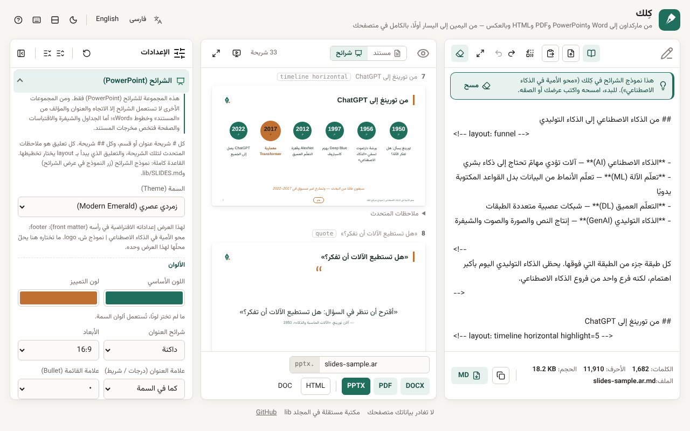

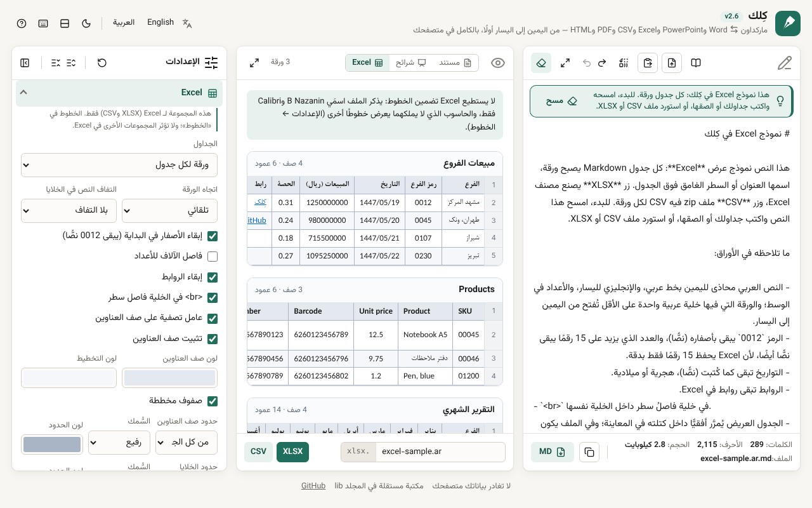

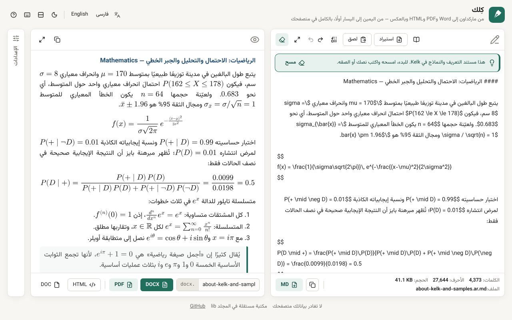

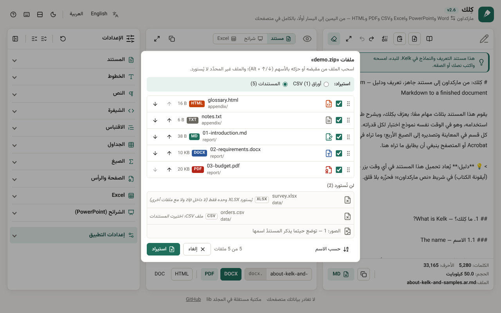

### الاستخدام

- **على الإنترنت:** [mohsen-1984.github.io/kelk](https://mohsen-1984.github.io/kelk/)
- **على حاسوبك:** نزّل [kelk_2.6.zip](https://github.com/mohsen-1984/kelk/releases/latest/download/kelk_2.6.zip) وافتحه ثم افتح `index.html`؛ يعمل دون إنترنت، للاستخدام الشخصي أو داخل شبكة المؤسسة.
- **على استضافتك:** ارفع المجلد إلى أي استضافة ويب ثابتة.

يُفتح مستند التعريف والدليل في الزيارة الأولى بلغة الواجهة:
[العربية](docs/about-kelk-and-samples.ar.md) · [English](docs/about-kelk-and-samples.en.md) ·
[فارسی](docs/about-kelk-and-samples.fa.md).
المجلد `lib/` مكتبة JavaScript مستقلة؛ توثيقها بالإنجليزية: [`lib/README.md`](lib/README.md).

### التواصل والشكر والترخيص

للأسئلة والاقتراحات: **[mhn.com@gmail.com](mailto:mhn.com@gmail.com)** (البريد الإلكتروني أفضل وسيلة للتواصل).
الشيفرة بترخيص **MIT**؛ وللمكتبات والخطوط تراخيصها الخاصة (`THIRD-PARTY-NOTICES.md`).
Vazirmatn وVazir Code وSahel من عمل الراحل [صابر راستي كردار](https://github.com/rastikerdar)، رحمه الله.
B Nazanin وB Mitra وB Titr: (c) Borna Rayaneh, no published license, see borna-rayaneh/NOTICE.txt
([`lib/pdf-base64-ttf-fonts/borna-rayaneh/NOTICE.txt`](lib/pdf-base64-ttf-fonts/borna-rayaneh/NOTICE.txt)).

</div>
